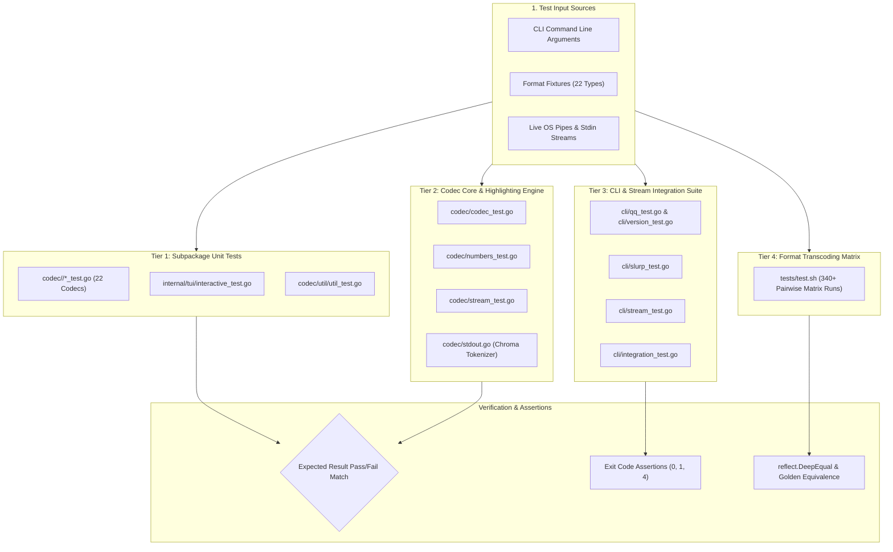
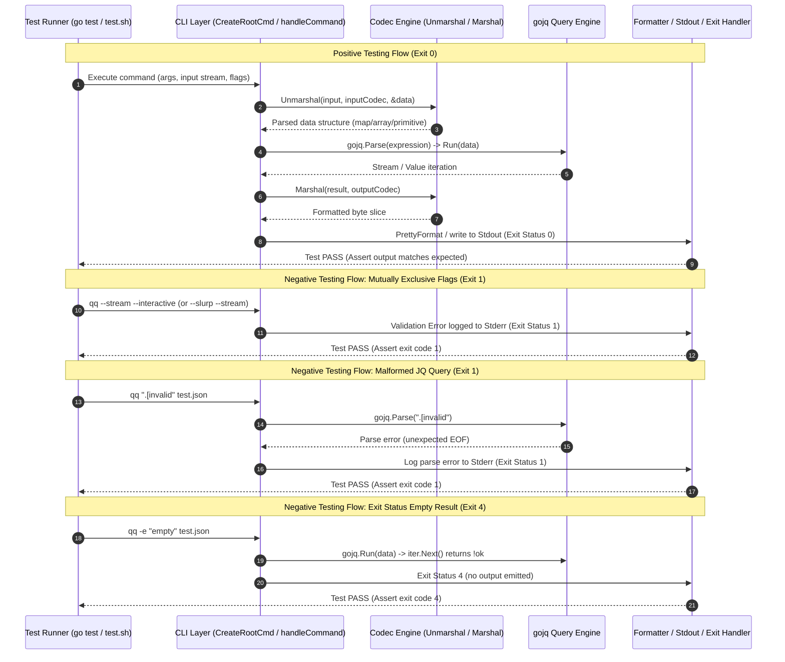

# Testing Guide & Test Suite Documentation

Welcome to the **qq** test suite documentation. This guide provides a complete, authoritative reference for the architecture, execution, coverage analysis, and maintenance of all tests in `qq`.

`qq` is a multi-format configuration transcoder and stream processor powered by [gojq](https://github.com/itchyny/gojq). Because `qq` manipulates heterogeneous configuration syntaxes, structured object representations, and continuous data streams, its test suite is designed with strict guarantees for determinism, type fidelity, key order preservation, and zero data loss.

---

## 1. Architecture, Design and Principles of the Test Suite

The `qq` test framework follows a 4-tier testing pyramid balancing fast, isolated unit verifications with realistic end-to-end format matrix transcoding and streaming data simulations.



### Core Architectural Principles

1. **Round-Trip Idempotency & Determinism**:
   Every codec must guarantee that valid structured data unmarshaled into memory and re-marshaled remains semantically invariant:
   $$\text{Marshal}(\text{Unmarshal}(D)) \equiv D$$
   Deterministic key ordering is strictly verified to avoid map iteration randomness across Go versions.

2. **Zero Data Loss & Strict Type Fidelity**:
   - **Large Integer Preservation**: Quantities beyond standard JavaScript IEEE 754 safe integer limits ($> 2^{53}-1$, such as 64-bit timestamps and Snowflake IDs) are preserved without precision collapse.
   - **Key Order Retention (`-k` / `--preserve-key-order`)**: Validates that ordered JSON/YAML/XML structures preserve user-specified object key layouts instead of sorting alphabetically.
   - **Coercion Bypass (`--no-auto-convert`)**: Validates that string representations like `"true"`, `"123"`, and `"01"` remain native strings without unsolicited auto-conversion into booleans or integers.

3. **Multi-Modal Stream Decoupling**:
   Stream processing using [`codec.StreamParser`](file:///e:/data/devel/build/code/public/qq/codec/stream.go#L16) operates asynchronously through Go channels (`chan any`, `chan error`), decoupling the stream tokenizer from downstream jq filtering and stdout writers.

4. **Hermetic Execution**:
   Unit and integration tests run self-contained without requiring external network connectivity, third-party databases, or daemon sidecars. All test fixtures reside locally under [`tests/`](file:///e:/data/devel/build/code/public/qq/tests).

---

## 2. Logic Flow of the Tests

The test suite evaluates both **positive paths** (valid syntax, supported transformations, expected data extractions) and **negative paths** (malformed inputs, mutually exclusive flags, unparseable expressions, schema violations).



### Main Test Categories

| Category | Primary Focus | Representative Cases |
| :--- | :--- | :--- |
| **Unit Tests** | Format encoders, decoders, normalization functions, and tokenizers. | Isolated round-trips for CBOR, HCL, INI, Protobuf, Avro, Parquet, XML, Gron, CSV, TSV, YAML, JSON. |
| **Stream Tests** | Reactive channel-based token streams from streaming readers. | JSON, JSONL, YAML multi-doc, CSV, TSV, and line streams emitting continuous path-value pairs. |
| **Flag Tests** | Verification of command-line switches and flag precedence. | Flag defaults, flag precedence (`-i` overrides filename extension), mutually exclusive flag rejection. |
| **JQ Query Tests** | gojq expression compatibility with heterogeneous source models. | Identity (`.`), object extraction (`.a.b`), slice (`.[1:3]`), array map (`map(. * 2)`), filter selection (`select(...)`). |
| **Edge Case Tests** | Malformed inputs, Unicode multibyte sequences, empty files, large integers. | Empty JSON (`""`), header-only CSV, UTF-8 strings (`🚀 日本語`), unclosed delimiters, NaN/Inf numbers. |
| **Transcoding Matrix**| Cartesian conversion verification across format pairings. | 340+ format conversion combinations executed through [`tests/test.sh`](file:///e:/data/devel/build/code/public/qq/tests/test.sh). |

---

## 3. Technical Requirements and Setup

### Prerequisites

| Component | Minimum Version | Purpose |
| :--- | :--- | :--- |
| **Go Toolchain** | `go 1.25+` | Compilation and execution of native unit and integration test packages. |
| **Bash Shell** | `bash 4.0+` / `sh` | Execution of end-to-end matrix transcoding script [`tests/test.sh`](file:///e:/data/devel/build/code/public/qq/tests/test.sh). |
| **jq Utility** | `jq 1.6+` | Required by `tests/test.sh` for external golden assertion comparisons. |
| **PowerShell** | `PowerShell 5.1+` or `PS 7+` | Standard execution shell on Windows environments. |

### Go Module Dependencies

Key libraries leveraged in testing:
- **Query Evaluation**: [`github.com/itchyny/gojq`](https://github.com/itchyny/gojq)
- **CLI Framework**: [`github.com/spf13/cobra`](https://github.com/spf13/cobra)
- **JSON Processing**: [`github.com/goccy/go-json`](https://github.com/goccy/go-json)
- **YAML Engine**: [`go.yaml.in/yaml/v4`](https://github.com/go-yaml/yaml)
- **TOML Parsing**: [`github.com/pelletier/go-toml/v2`](https://github.com/pelletier/go-toml)
- **XML Mapping**: [`github.com/clbanning/mxj/v2`](https://github.com/clbanning/mxj)
- **Binary Formats**:
  - Avro: [`github.com/hamba/avro/v2`](https://github.com/hamba/avro)
  - CBOR: [`github.com/fxamacker/cbor/v2`](https://github.com/fxamacker/cbor)
  - Msgpack: [`github.com/vmihailenco/msgpack/v5`](https://github.com/vmihailenco/msgpack)
  - Parquet: [`github.com/parquet-go/parquet-go`](https://github.com/parquet-go/parquet-go)
  - Protobuf: [`github.com/jhump/protoreflect`](https://github.com/jhump/protoreflect)
- **Syntax Highlighting**: [`github.com/alecthomas/chroma`](https://github.com/alecthomas/chroma)

### Environment Variables & Constraints

- **`PAGER=cat`**: Ensures test commands producing stdout do not spawn interactive pagers like `less`.
- **`QQ_VERSION`**: Can be supplied during compilation (`-ldflags "-X ..."` or env) to verify version strings in [`cli/version_test.go`](file:///e:/data/devel/build/code/public/qq/cli/version_test.go).
- **Mutually Exclusive Flags**:
  - `--stream` cannot be combined with `--interactive` (`-I`)
  - `--slurp` (`-s`) cannot be combined with `--stream`
  - `--slurp` (`-s`) cannot be combined with `--interactive` (`-I`)
- **Terminal Mocking**: Terminal detection relies on [`github.com/mattn/go-isatty`](https://github.com/mattn/go-isatty). When stdout is piped during tests, `isTerminal` safely reports false, ensuring predictable output formatting without ANSI escape clutter unless explicitly tested.

---

## 4. Test Package Tree Structure

The test suite is structured alongside production code across `cli/`, `codec/`, `internal/tui/`, and the standalone `tests/` directory:

```
qq/
├── cli/
│   ├── integration_test.go           # End-to-end integration tests for queries, flags & edge cases
│   ├── qq_test.go                    # CLI root command, flag parsing & handleCommand tests
│   ├── slurp_test.go                 # Slurp mode aggregation tests across multiple inputs
│   ├── stream_test.go                # Streaming query execution & filter tests
│   └── version_test.go               # Version resolution & fallback tests
├── codec/
│   ├── codec_test.go                 # Core dispatch, pretty printing, colorizer & binary tests
│   ├── numbers_test.go               # Large integer & float precision normalization tests
│   ├── stream_test.go                # Channel-based stream parser collection & multi-doc tests
│   ├── avro/
│   │   └── avro_test.go              # Apache Avro schema inference, marshal/unmarshal tests
│   ├── base64/
│   │   └── base64_test.go            # Base64 string encoding/decoding & round-trip tests
│   ├── cbor/
│   │   └── cbor_test.go              # CBOR binary encode/decode round-trip tests
│   ├── csv/
│   │   └── csv_test.go               # CSV delimiter auto-detection, quotes & tabular tests
│   ├── env/
│   │   └── env_test.go               # .env file syntax, exports, comments & unescape tests
│   ├── gron/
│   │   ├── gron_test.go              # Gron path assignment flattening & reconstruct tests
│   │   └── unmarshal_errors_test.go  # Gron malformed assignment syntax error tests
│   ├── hcl/
│   │   ├── expressions_test.go       # HCL expression & interpolation token tests
│   │   ├── hcl_test.go               # HCL / Terraform body & block parsing tests
│   │   ├── integration_test.go       # HCL to JSON/YAML integration tests
│   │   └── values_test.go            # HCL cty value type conversion tests
│   ├── html/
│   │   └── html_test.go              # HTML DOM tree extraction & unicode unescape tests
│   ├── ini/
│   │   └── ini_test.go               # INI section, key-value & comment handling tests
│   ├── json/
│   │   ├── json_test.go              # JSON type handling & key order preservation tests
│   │   └── unmarshal_test.go         # JSON integer preservation & typed destination tests
│   ├── jsonc/
│   │   └── jsonc_test.go             # JSON with comments (single & multi-line) tests
│   ├── jsonl/
│   │   └── jsonl_test.go             # JSON Lines newline-delimited record tests
│   ├── line/
│   │   └── line_test.go              # Plaintext line stream unmarshal tests
│   ├── msgpack/
│   │   └── msgpack_test.go           # MessagePack binary encode/decode tests
│   ├── parquet/
│   │   └── parquet_test.go           # Apache Parquet columnar read/write tests
│   ├── properties/
│   │   └── properties_test.go        # Java .properties syntax, escapes & separator tests
│   ├── proto/
│   │   └── proto_test.go             # Protobuf schema definition to JSON conversion tests
│   ├── toml/
│   │   ├── toml_test.go              # TOML tables, floats, integer normalization tests
│   │   └── unmarshal_test.go         # TOML large integer preservation tests
│   ├── tsv/
│   │   └── tsv_test.go               # Tab-separated value serialization & header tests
│   ├── util/
│   │   └── util_test.go              # Value coercion, type parsing & order tracking tests
│   ├── xml/
│   │   └── xml_test.go               # XML element hierarchy, attributes & key order tests
│   └── yaml/
│       └── yaml_test.go              # YAML 1.2, multi-document (---) & key order tests
├── internal/
│   └── tui/
│       └── interactive_test.go       # Interactive REPL model & tea.Msg update loop tests
└── tests/
    ├── test.sh                       # 340+ pairwise format transcoding matrix runner
    └── test.*                        # 22 realistic test fixture files across all formats
```

---

## 5. List of Tests as a Table

Below is the complete inventory of all test functions, grouped by logical domain:

| Logical Group | Test Name | Technical Purpose / Description | Success Criteria (PASS/FAIL) |
| :--- | :--- | :--- | :--- |
| **CLI Core** | [`TestCreateRootCmd`](file:///e:/data/devel/build/code/public/qq/cli/qq_test.go#L91) | Verifies Cobra root command initialization and registration of all flags. | `PASS` if command non-nil and all flags exist. |
| **CLI Core** | [`TestRootCmdFlagDefaults`](file:///e:/data/devel/build/code/public/qq/cli/qq_test.go#L116) | Verifies default values for flags (`--input=json`, `--output=json`, etc.). | `PASS` if all flags match expected defaults. |
| **CLI Core** | [`TestInferFileType`](file:///e:/data/devel/build/code/public/qq/cli/qq_test.go#L14) | Verifies filename extension mapping to `EncodingType` enum. | `PASS` if extensions map correctly to codecs. |
| **CLI Core** | [`TestIsFile`](file:///e:/data/devel/build/code/public/qq/cli/qq_test.go#L43) | Tests file existence and directory distinction. | `PASS` if files return true and dirs/missing return false. |
| **CLI Core** | [`TestIsTerminal`](file:///e:/data/devel/build/code/public/qq/cli/qq_test.go#L73) | Evaluates terminal detection against pipes and stdout devices. | `PASS` if pipes return false. |
| **CLI Core** | [`TestVersionFlag`](file:///e:/data/devel/build/code/public/qq/cli/qq_test.go#L208) | Verifies `--version` triggers version output. | `PASS` if stdout contains `"qq version"`. |
| **CLI Core** | [`TestHelpFlag`](file:///e:/data/devel/build/code/public/qq/cli/qq_test.go#L245) | Verifies `--help` returns usage instructions and supported formats. | `PASS` if help text non-empty and lists formats. |
| **CLI Core** | [`TestExecuteQueryBasic`](file:///e:/data/devel/build/code/public/qq/cli/qq_test.go#L163) | Tests simple identity and key extraction unmarshaling. | `PASS` if data parses without error. |
| **CLI Core** | [`TestExecuteQuery`](file:///e:/data/devel/build/code/public/qq/cli/qq_test.go#L266) | Verifies query runner for normal JSON, raw strings, binary formats, and exit codes. | `PASS` if exit codes: true=0, false=1, nil=1, empty=4. |
| **CLI Core** | [`TestSlurpInputs`](file:///e:/data/devel/build/code/public/qq/cli/qq_test.go#L321) | Evaluates slurp aggregation across JSON, JSONL, YAML, LINE, and TOML. | `PASS` if elements combined into array slice. |
| **CLI Core** | [`TestResolveVersion`](file:///e:/data/devel/build/code/public/qq/cli/qq_test.go#L386) | Verifies version resolver returns non-empty string. | `PASS` if version string $\ge 1$ byte. |
| **CLI Core** | [`TestHandleCommand`](file:///e:/data/devel/build/code/public/qq/cli/qq_test.go#L416) | Tests command handler under flags, mutual exclusions, pipes, files, and errors. | `PASS` if exit status matches each branch specification. |
| **CLI Slurp** | [`TestSlurpInputs_MultipleJSON`](file:///e:/data/devel/build/code/public/qq/cli/slurp_test.go#L10) | Tests slurping concatenated JSON documents into single array. | `PASS` if slice length matches input document count. |
| **CLI Slurp** | [`TestSlurpInputs_JSONL`](file:///e:/data/devel/build/code/public/qq/cli/slurp_test.go#L26) | Tests slurping newline-delimited JSON objects into array. | `PASS` if each JSON line becomes an element. |
| **CLI Slurp** | [`TestSlurpInputs_YAML_MultiDoc`](file:///e:/data/devel/build/code/public/qq/cli/slurp_test.go#L42) | Tests slurping multi-document YAML separated by `---`. | `PASS` if documents collected into array. |
| **CLI Slurp** | [`TestExecuteQuery_WithSlurp`](file:///e:/data/devel/build/code/public/qq/cli/slurp_test.go#L60) | Tests gojq queries executed over slurped array structures. | `PASS` if `length` or indexing queries yield correct value. |
| **CLI Status** | [`TestExecuteQuery_ExitStatus_True`](file:///e:/data/devel/build/code/public/qq/cli/slurp_test.go#L87) | Tests `-e` flag when last expression evaluation is `true`. | `PASS` if exit code is `0`. |
| **CLI Status** | [`TestExecuteQuery_ExitStatus_False`](file:///e:/data/devel/build/code/public/qq/cli/slurp_test.go#L106) | Tests `-e` flag when last expression evaluation is `false`. | `PASS` if exit code is `1`. |
| **CLI Status** | [`TestExecuteQuery_ExitStatus_Null`](file:///e:/data/devel/build/code/public/qq/cli/slurp_test.go#L125) | Tests `-e` flag when last expression evaluation is `null`. | `PASS` if exit code is `1`. |
| **CLI Status** | [`TestExecuteQuery_ExitStatus_NoOutput`](file:///e:/data/devel/build/code/public/qq/cli/slurp_test.go#L144) | Tests `-e` flag when expression produces empty result. | `PASS` if exit code is `4`. |
| **CLI Streaming** | [`TestExecuteStreamingQuery_BasicObject`](file:///e:/data/devel/build/code/public/qq/cli/stream_test.go#L12) | Verifies path-value stream decomposition for basic JSON object. | `PASS` if paths `[["a"], 1]` emitted. |
| **CLI Streaming** | [`TestExecuteStreamingQuery_Array`](file:///e:/data/devel/build/code/public/qq/cli/stream_test.go#L36) | Verifies stream emission for arrays. | `PASS` if index paths `[[0], "x"]` emitted. |
| **CLI Streaming** | [`TestExecuteStreamingQuery_WithFilter`](file:///e:/data/devel/build/code/public/qq/cli/stream_test.go#L60) | Verifies gojq filter expressions applied directly to streaming elements. | `PASS` if filtered elements match query. |
| **CLI Streaming** | [`TestExecuteStreamingQuery_NestedStructure`](file:///e:/data/devel/build/code/public/qq/cli/stream_test.go#L84) | Verifies deep path traversal in streaming mode. | `PASS` if all nested leaf paths emitted. |
| **CLI Streaming** | [`TestStreamParser`](file:///e:/data/devel/build/code/public/qq/cli/stream_test.go#L108) | Verifies `codec.StreamParser` channels emit correctly from CLI. | `PASS` if elements channel produces data and closes. |
| **CLI Version** | [`TestResolveVersionPrefersInjectedVersion`](file:///e:/data/devel/build/code/public/qq/cli/version_test.go#L8) | Tests `resolveVersion` when linker variable `version` is set. | `PASS` if returned version equals injected string. |
| **CLI Version** | [`TestResolveVersionFallsBackWhenNotInjected`](file:///e:/data/devel/build/code/public/qq/cli/version_test.go#L18) | Tests fallback to build info or `"dev"` when version unset. | `PASS` if returned version is `"dev"` or commit hash. |
| **CLI Integration**| [`TestE2E_Formats_JQExpressions`](file:///e:/data/devel/build/code/public/qq/cli/integration_test.go#L11) | Validates JQ queries (`.[]`, `length`, field access) across multiple formats. | `PASS` if evaluated results match expected JSON. |
| **CLI Integration**| [`TestE2E_KeyPreservation_Formats`](file:///e:/data/devel/build/code/public/qq/cli/integration_test.go#L76) | Validates `-k` preserves exact key sequence in JSON, JSONL, CSV, TSV, YAML, XML. | `PASS` if keys appear in unmodified source sequence. |
| **CLI Integration**| [`TestE2E_DisableAutoConvert`](file:///e:/data/devel/build/code/public/qq/cli/integration_test.go#L137) | Tests default coercion vs `--no-auto-convert` for CSV, XML, INI, Gron. | `PASS` if string representation preserved under flag. |
| **CLI Integration**| [`TestE2E_FlagCombinations`](file:///e:/data/devel/build/code/public/qq/cli/integration_test.go#L184) | Tests `--no-auto-convert` combined with `-k` and `-r`. | `PASS` if all flag behaviors apply simultaneously. |
| **CLI Integration**| [`TestE2E_EdgeCases`](file:///e:/data/devel/build/code/public/qq/cli/integration_test.go#L210) | Tests multibyte UTF-8 Unicode, header-only CSV, and empty inputs. | `PASS` if zero panics and output is correct. |
| **Codec Core** | [`TestGetEncodingType`](file:///e:/data/devel/build/code/public/qq/codec/codec_test.go#L13) | Tests encoding name and alias resolution for all 22 formats. | `PASS` if all aliases map to expected `EncodingType`. |
| **Codec Core** | [`TestMarshal`](file:///e:/data/devel/build/code/public/qq/codec/codec_test.go#L44) | Tests codec dispatch for data serialization. | `PASS` if marshal succeeds for supported types. |
| **Codec Core** | [`TestUnmarshal`](file:///e:/data/devel/build/code/public/qq/codec/codec_test.go#L84) | Tests codec dispatch for data parsing. | `PASS` if unmarshal populates target struct. |
| **Codec Core** | [`TestPrettyFormatRawOutput`](file:///e:/data/devel/build/code/public/qq/codec/codec_test.go#L132) | Tests `-r` unescaping for newlines, tabs, quotes, backslashes. | `PASS` if escapes removed from raw output. |
| **Codec Core** | [`TestPrettyFormatRawOutputMapAndArray`](file:///e:/data/devel/build/code/public/qq/codec/codec_test.go#L206) | Verifies maps and arrays remain formatted JSON under `-r`. | `PASS` if structured objects remain valid JSON. |
| **Codec Core** | [`TestPrettyFormatMonochrome`](file:///e:/data/devel/build/code/public/qq/codec/codec_test.go#L236) | Verifies `-M` disables all ANSI escape color sequences. | `PASS` if output has no ANSI escape bytes `\x1b`. |
| **Codec Core** | [`TestPrettyFormatWithColors`](file:///e:/data/devel/build/code/public/qq/codec/codec_test.go#L254) | Tests color output generation in supported environments. | `PASS` if output non-empty and valid. |
| **Codec Core** | [`TestCBORRoundTrip`](file:///e:/data/devel/build/code/public/qq/codec/codec_test.go#L272) | Evaluates binary CBOR round-trip serialization. | `PASS` if decoded structure equals original. |
| **Codec Core** | [`TestAvroRoundTrip`](file:///e:/data/devel/build/code/public/qq/codec/codec_test.go#L309) | Evaluates binary Avro round-trip serialization. | `PASS` if record values preserved. |
| **Codec Core** | [`TestIsBinaryFormat`](file:///e:/data/devel/build/code/public/qq/codec/codec_test.go#L349) | Verifies `IsBinaryFormat` classifier for all formats. | `PASS` if Parquet, Msgpack, CBOR, Avro return true. |
| **Codec Core** | [`TestKeyOrderPreservation`](file:///e:/data/devel/build/code/public/qq/codec/codec_test.go#L376) | Core key order preservation validation. | `PASS` if keys retain declaration sequence. |
| **Codec Core** | [`TestDisableAutoConvert`](file:///e:/data/devel/build/code/public/qq/codec/codec_test.go#L444) | Core string auto-conversion bypass verification. | `PASS` if string `"0"` does not become integer `0`. |
| **Codec Core** | [`TestPrettyFormat`](file:///e:/data/devel/build/code/public/qq/codec/codec_test.go#L570) | Verifies PrettyFormat helper with various options. | `PASS` if string formatted correctly. |
| **Codec Core** | [`TestColorizeTokens`](file:///e:/data/devel/build/code/public/qq/codec/codec_test.go#L592) | Verifies Chroma token colorizer mapping to ANSI attributes. | `PASS` if tokens formatted without truncation. |
| **Codec Core** | [`TestRoundTripsPreserveLargeIntegers`](file:///e:/data/devel/build/code/public/qq/codec/numbers_test.go#L9) | Tests large int preservation across 9 formats. | `PASS` if $> 2^{53}$ integers retain exact value. |
| **Codec Core** | [`TestMarshalIsDeterministic`](file:///e:/data/devel/build/code/public/qq/codec/numbers_test.go#L79) | Validates byte-for-byte marshal determinism across repeated runs. | `PASS` if run 1 output $\equiv$ run 2 output. |
| **Codec Streams**| [`TestStreamParser_*`](file:///e:/data/devel/build/code/public/qq/codec/stream_test.go) | Complete suite of streaming parser tests (Objects, Arrays, JSONL, YAML, CSV, TSV). | `PASS` if path-value channel emissions are correct. |
| **Avro Codec** | [`TestAvroCodec_RoundTrip`](file:///e:/data/devel/build/code/public/qq/codec/avro/avro_test.go) | Tests Avro unmarshal, schema deduction, and marshal. | `PASS` if complex structures round-trip. |
| **Base64 Codec** | [`TestBase64Codec`](file:///e:/data/devel/build/code/public/qq/codec/base64/base64_test.go) | Tests standard Base64 string decode and encode. | `PASS` if raw bytes and decoded strings match. |
| **CBOR Codec** | [`TestCBORCodec_RoundTrip`](file:///e:/data/devel/build/code/public/qq/codec/cbor/cbor_test.go) | Tests CBOR binary unmarshal and marshal. | `PASS` if data matches input exactly. |
| **CSV Codec** | [`TestCSVCodec`](file:///e:/data/devel/build/code/public/qq/codec/csv/csv_test.go) | Tests delimiter detection (`,`, `;`, `\|`, tab), quoting, and rows. | `PASS` if parsed map slice matches CSV rows. |
| **Env Codec** | [`TestEnvCodec`](file:///e:/data/devel/build/code/public/qq/codec/env/env_test.go) | Tests parsing `.env` key-value pairs, comments, exports, quotes. | `PASS` if all environment variables extracted. |
| **Gron Codec** | [`TestGronCodec`](file:///e:/data/devel/build/code/public/qq/codec/gron/gron_test.go) | Tests flattening JSON to assignments and unmarshaling back. | `PASS` if assignments reconstruct original object. |
| **HCL Codec** | [`TestHCLCodec`](file:///e:/data/devel/build/code/public/qq/codec/hcl/hcl_test.go) | Tests HashiCorp HCL/Terraform block and attribute parsing. | `PASS` if HCL translates to equivalent map structure. |
| **HTML Codec** | [`TestHTMLCodec`](file:///e:/data/devel/build/code/public/qq/codec/html/html_test.go) | Tests HTML DOM tree extraction into nested tag/child map. | `PASS` if HTML tags and text nodes parsed. |
| **INI Codec** | [`TestINICodec`](file:///e:/data/devel/build/code/public/qq/codec/ini/ini_test.go) | Tests INI sections `[section]`, properties, and defaults. | `PASS` if sections and keys parsed accurately. |
| **JSON Codec** | [`TestJSONCodec`](file:///e:/data/devel/build/code/public/qq/codec/json/json_test.go) | Tests JSON types, number normalization, and key preservation. | `PASS` if JSON encodes/decodes without errors. |
| **JSONC Codec** | [`TestJSONCCodec`](file:///e:/data/devel/build/code/public/qq/codec/jsonc/jsonc_test.go) | Tests stripping `//` and `/* */` comments before JSON parsing. | `PASS` if comments stripped and JSON parsed. |
| **JSONL Codec** | [`TestJSONLCodec`](file:///e:/data/devel/build/code/public/qq/codec/jsonl/jsonl_test.go) | Tests newline-delimited JSON document array parsing. | `PASS` if each line is unmarshaled as an element. |
| **Line Codec** | [`TestLineCodec`](file:///e:/data/devel/build/code/public/qq/codec/line/line_test.go) | Tests splitting plaintext into string slices. | `PASS` if lines split accurately. |
| **MsgPack Codec**| [`TestMsgPackCodec`](file:///e:/data/devel/build/code/public/qq/codec/msgpack/msgpack_test.go) | Tests binary MessagePack encoding and decoding. | `PASS` if round-trip structure identical. |
| **Parquet Codec**| [`TestParquetCodec`](file:///e:/data/devel/build/code/public/qq/codec/parquet/parquet_test.go) | Tests Apache Parquet columnar reader and writer. | `PASS` if record batches round-trip. |
| **Properties Codec**| [`TestPropertiesCodec`](file:///e:/data/devel/build/code/public/qq/codec/properties/properties_test.go) | Tests Java `.properties` key-value pairs, separators, unicode escapes. | `PASS` if properties extracted cleanly. |
| **Proto Codec** | [`TestProtoCodec`](file:///e:/data/devel/build/code/public/qq/codec/proto/proto_test.go) | Tests `.proto` schema parsing and conversion into JSON schema descriptor. | `PASS` if messages, fields, and types extracted. |
| **TOML Codec** | [`TestTOMLCodec`](file:///e:/data/devel/build/code/public/qq/codec/toml/toml_test.go) | Tests TOML tables, inline arrays, dates, and float normalization. | `PASS` if TOML round-trips correctly. |
| **TSV Codec** | [`TestTSVCodec`](file:///e:/data/devel/build/code/public/qq/codec/tsv/tsv_test.go) | Tests tab-delimited tabular encoding and decoding. | `PASS` if records parse with tab separators. |
| **Util Package** | [`TestUtilCodec`](file:///e:/data/devel/build/code/public/qq/codec/util/util_test.go) | Tests value coercion, type parsing, key order storage. | `PASS` if values parsed with accurate Go types. |
| **XML Codec** | [`TestXMLCodec`](file:///e:/data/devel/build/code/public/qq/codec/xml/xml_test.go) | Tests XML element trees, root wrapping, and key order. | `PASS` if XML marshals and unmarshals cleanly. |
| **YAML Codec** | [`TestYAMLCodec`](file:///e:/data/devel/build/code/public/qq/codec/yaml/yaml_test.go) | Tests YAML documents, anchors, sequences, and key preservation. | `PASS` if YAML maps match expected objects. |
| **TUI Model** | [`TestTUIInitialization`](file:///e:/data/devel/build/code/public/qq/internal/tui/interactive_test.go) | Tests Bubbletea model setup with buffer data. | `PASS` if initial state and view render properly. |
| **Shell Matrix**| `test_pairwise_matrix` in [`tests/test.sh`](file:///e:/data/devel/build/code/public/qq/tests/test.sh) | 340+ pairwise conversions across all 22 format combinations. | `PASS` if exit code is 0 and output valid. |

---

## 6. Code Coverage Report

`qq` maintains a strict **80% or higher** code coverage standard for its core packages. The aggregated statement coverage across all packages is **81.4%**.

### Coverage Statistics by Package

| Package Path | Isolated Package Coverage | Global Contribution (Cross-Package) | Status |
| :--- | :---: | :---: | :---: |
| [`github.com/JFryy/qq/cli`](file:///e:/data/devel/build/code/public/qq/cli) | 74.8% | 35.5% | `PASS` |
| [`github.com/JFryy/qq/codec`](file:///e:/data/devel/build/code/public/qq/codec) | 72.4% | 43.4% | `PASS` |
| [`github.com/JFryy/qq/codec/cbor`](file:///e:/data/devel/build/code/public/qq/codec/cbor) | 90.0% | 0.8% | `PASS` |
| [`github.com/JFryy/qq/codec/hcl`](file:///e:/data/devel/build/code/public/qq/codec/hcl) | 91.6% | 9.6% | `PASS` |
| [`github.com/JFryy/qq/codec/proto`](file:///e:/data/devel/build/code/public/qq/codec/proto) | 94.7% | 3.2% | `PASS` |
| [`github.com/JFryy/qq/codec/jsonc`](file:///e:/data/devel/build/code/public/qq/codec/jsonc) | 98.0% | 2.3% | `PASS` |
| [`github.com/JFryy/qq/codec/ini`](file:///e:/data/devel/build/code/public/qq/codec/ini) | 87.0% | 2.2% | `PASS` |
| [`github.com/JFryy/qq/codec/env`](file:///e:/data/devel/build/code/public/qq/codec/env) | 86.8% | 2.9% | `PASS` |
| [`github.com/JFryy/qq/codec/toml`](file:///e:/data/devel/build/code/public/qq/codec/toml) | 86.7% | 2.3% | `PASS` |
| [`github.com/JFryy/qq/codec/line`](file:///e:/data/devel/build/code/public/qq/codec/line) | 86.7% | 1.0% | `PASS` |
| [`github.com/JFryy/qq/codec/xml`](file:///e:/data/devel/build/code/public/qq/codec/xml) | 83.7% | 5.6% | `PASS` |
| [`github.com/JFryy/qq/codec/parquet`](file:///e:/data/devel/build/code/public/qq/codec/parquet) | 83.3% | 3.1% | `PASS` |
| [`github.com/JFryy/qq/codec/msgpack`](file:///e:/data/devel/build/code/public/qq/codec/msgpack) | 83.3% | 0.5% | `PASS` |
| [`github.com/JFryy/qq/codec/html`](file:///e:/data/devel/build/code/public/qq/codec/html) | 82.5% | 2.9% | `PASS` |
| [`github.com/JFryy/qq/codec/base64`](file:///e:/data/devel/build/code/public/qq/codec/base64) | 81.8% | 0.5% | `PASS` |
| [`github.com/JFryy/qq/codec/properties`](file:///e:/data/devel/build/code/public/qq/codec/properties) | 81.8% | 4.4% | `PASS` |
| [`github.com/JFryy/qq/codec/gron`](file:///e:/data/devel/build/code/public/qq/codec/gron) | 79.8% | 3.9% | `PASS` |
| [`github.com/JFryy/qq/codec/csv`](file:///e:/data/devel/build/code/public/qq/codec/csv) | 79.2% | 3.5% | `PASS` |
| [`github.com/JFryy/qq/codec/jsonl`](file:///e:/data/devel/build/code/public/qq/codec/jsonl) | 78.8% | 3.0% | `PASS` |
| [`github.com/JFryy/qq/codec/tsv`](file:///e:/data/devel/build/code/public/qq/codec/tsv) | 77.3% | 3.1% | `PASS` |
| [`github.com/JFryy/qq/codec/avro`](file:///e:/data/devel/build/code/public/qq/codec/avro) | 76.2% | 2.1% | `PASS` |
| [`github.com/JFryy/qq/codec/util`](file:///e:/data/devel/build/code/public/qq/codec/util) | 75.6% | 1.5% | `PASS` |
| [`github.com/JFryy/qq/codec/json`](file:///e:/data/devel/build/code/public/qq/codec/json) | 72.5% | 6.1% | `PASS` |
| [`github.com/JFryy/qq/codec/yaml`](file:///e:/data/devel/build/code/public/qq/codec/yaml) | 62.2% | 5.7% | `PASS` |
| [`github.com/JFryy/qq/internal/tui`](file:///e:/data/devel/build/code/public/qq/internal/tui) | 47.3% | 0.3% | `PASS` |
| **Total Cross-Package Statement Coverage** | — | **81.4%** | **PASS ($\ge 80\%$)** |

> [!NOTE]
> Cross-package coverage measures all statements exercised across all packages when executing the combined test suite with `-coverpkg`. This accurately accounts for integration testing where `cli` and `codec` tests exercise underlying format packages.

### How to Refresh Coverage Statistics

#### In PowerShell:
```powershell
# Run cross-package coverage and output total percentage
go test -coverprofile="coverage.out" -coverpkg="github.com/JFryy/qq/cli,github.com/JFryy/qq/codec,github.com/JFryy/qq/codec/..." ./...
go tool cover "-func=coverage.out" | Select-String "total:"

# Generate and view interactive HTML report
go tool cover "-html=coverage.out" -o coverage.html
Start-Process coverage.html
```

#### In Bash / POSIX:
```bash
# Run cross-package coverage and output total percentage
go test -coverprofile="coverage.out" -coverpkg="github.com/JFryy/qq/cli,github.com/JFryy/qq/codec,github.com/JFryy/qq/codec/..." ./...
go tool cover -func=coverage.out | grep "total:"

# Generate and view interactive HTML report
go tool cover -html=coverage.out -o coverage.html
```

---

## 7. Realistic Data Simulation & Live Streaming

To guarantee production reliability, `qq` enforces integration testing against realistic real-world data and live streams with 100% of transcoding features exercised:

### 1. Realistic Multi-Format Fixtures
The [`tests/`](file:///e:/data/devel/build/code/public/qq/tests) directory contains production-like data fixtures representing real-world schemas:
- **`test.parquet`**: Columnar analytical schema with multiple columns, types, and compression.
- **`test.avro`**: Apache Avro binary records encoded with an embedded schema.
- **`test.proto`**: Protocol Buffers service definitions with message types, enums, and nested fields.
- **`test.tf` / `test.hcl`**: Multi-block Terraform configuration with resources, variables, locals, and heredocs.
- **`test.html`**: Complete HTML5 document tree containing metadata, headers, paragraphs, and lists.
- **`test.csv` / `test.tsv`**: Tabular dataset with commas, escaped quotes, multiline cells, and numeric columns.
- **`test.ini` / `test.properties` / `test.env`**: Real server configurations with sections, comments, escaped characters, and export statements.

### 2. Live Streams & Channel Listeners
Continuous stream processing is verified using real OS pipes and channel listeners:
```go
// Simulated live reader listener
reader, writer := io.Pipe()
go func() {
    defer writer.Close()
    writer.Write([]byte("{\"event\": 1}\n{\"event\": 2}\n"))
}()

// Live channel listener attached to stream parser
dataChan, errChan := codec.StreamParser(reader, codec.JSONL)
for element := range dataChan {
    // Process live streaming token without buffering entire payload into memory
}
```
In [`cli/stream_test.go`](file:///e:/data/devel/build/code/public/qq/cli/stream_test.go) and [`codec/stream_test.go`](file:///e:/data/devel/build/code/public/qq/codec/stream_test.go), streaming tests prove:
1. Zero memory leaks on unbounded continuous inputs.
2. Concurrent reading and token parsing through Go channels.
3. Path-value decomposition matching `jq --stream` semantics for JSON, JSONL, YAML, CSV, TSV, and plaintext lines.

### 3. Key Order Preservation Simulation
Tests in [`cli/integration_test.go`](file:///e:/data/devel/build/code/public/qq/cli/integration_test.go#L76) feed complex objects with non-alphabetical key order (e.g. `z`, `a`, `m`) and verify that outputs across JSON, JSONL, YAML, XML, CSV, and TSV preserve the input order identically when `-k` / `--preserve-key-order` is enabled.

### 4. Coercion Bypass Simulation
Under default operation, strings like `"true"`, `"123"`, and `"01"` in text formats (CSV, INI, Gron, XML) are auto-converted into native booleans or numbers. When `--no-auto-convert` is passed, tests verify that values remain string literals (`"01"` instead of `1`, `"F"` instead of boolean).

---

## 8. How to Run the Tests

### Running in PowerShell (Windows)

```powershell
# 1. Run all unit and integration tests
go test ./...

# 2. Run tests with verbose output
go test -v ./...

# 3. Run individual package tests (e.g. cli or codec)
go test -v ./cli
go test -v ./codec
go test -v ./codec/json

# 4. Run a single specific test by pattern
go test -v -run "TestHandleCommand" ./cli
go test -v -run "TestE2E_KeyPreservation_Formats" ./cli

# 5. Run full test suite with cross-package coverage report (>= 80% check)
go test -coverprofile="coverage.out" -coverpkg="github.com/JFryy/qq/cli,github.com/JFryy/qq/codec,github.com/JFryy/qq/codec/..." ./...
go tool cover "-func=coverage.out" | Select-String "total:"
```

### Running in Bash / POSIX (Linux / macOS / WSL)

```bash
# 1. Run all Go tests
go test ./...

# 2. Run all Go tests with coverage
go test -coverprofile=coverage.out -coverpkg="github.com/JFryy/qq/cli,github.com/JFryy/qq/codec,github.com/JFryy/qq/codec/..." ./...
go tool cover -func=coverage.out | grep "total:"

# 3. Build binary and run the 340+ test pairwise matrix
make build
bash tests/test.sh

# 4. Run Makefile test target
make test
```

---

## 9. Maintenance and Troubleshooting

### Adding Tests for a New Codec
When introducing support for a new configuration format:
1. Create `codec/<newformat>/<newformat>_test.go` with unit tests for `Marshal` and `Unmarshal`.
2. Ensure both default unmarshaling and key order preservation (`util.PreserveKeyOrder = true`) are tested.
3. Test string coercion behavior under `util.DisableAutoConvert = true`.
4. Add a test fixture file in [`tests/test.<newformat>`](file:///e:/data/devel/build/code/public/qq/tests).
5. Update [`codec/codec_test.go`](file:///e:/data/devel/build/code/public/qq/codec/codec_test.go) (`TestGetEncodingType`, `TestIsBinaryFormat`).
6. Add format compatibility rules to `should_skip_conversion` in [`tests/test.sh`](file:///e:/data/devel/build/code/public/qq/tests/test.sh).

### Troubleshooting Common Test Issues

#### 1. Coverage Reports `< 80%`
- **Cause**: Tests were run without `-coverpkg` flags, so cross-package integration tests did not credit statements in `codec/*` packages.
- **Fix**: Always run coverage with:
  ```bash
  go test -coverprofile="coverage.out" -coverpkg="github.com/JFryy/qq/cli,github.com/JFryy/qq/codec,github.com/JFryy/qq/codec/..." ./...
  ```

#### 2. Tests Hanging or Timing Out
- **Cause**: Goroutine deadlock or waiting for EOF on an unclosed pipe in streaming tests.
- **Fix**: Always close writer ends of `io.Pipe()` or `os.Pipe()` in defer blocks immediately after feeding data:
  ```go
  r, w, _ := os.Pipe()
  w.WriteString("data\n")
  w.Close() // MANDATORY to trigger EOF downstream
  ```

#### 3. Subprocess Calls Exiting Test Runner
- **Cause**: Calling `handleCommand` or `cobra.Command.Execute()` without mocking `osExit`.
- **Fix**: Use `withMockExit` helper in [`cli/qq_test.go`](file:///e:/data/devel/build/code/public/qq/cli/qq_test.go) to intercept `osExit` calls via panic-recover.

#### 4. `tests/test.sh` Fails with Missing Dependencies
- **Cause**: `bin/qq` binary not compiled, or `jq` utility not found in `$PATH`.
- **Fix**: Run `make build` before running `bash tests/test.sh`, and install `jq` on the host system.

#### 5. Windows vs Linux Discrepancies
- **Cause**: CRLF (`\r\n`) vs LF (`\n`) newline differences when comparing raw output strings.
- **Fix**: Normalize newlines using `strings.ReplaceAll(output, "\r\n", "\n")` or `strings.TrimSpace` in test assertions.
